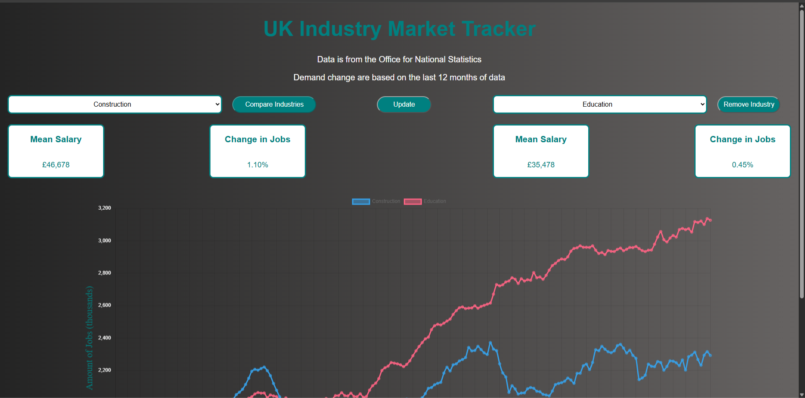
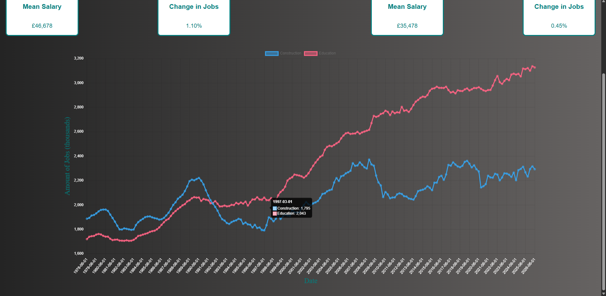
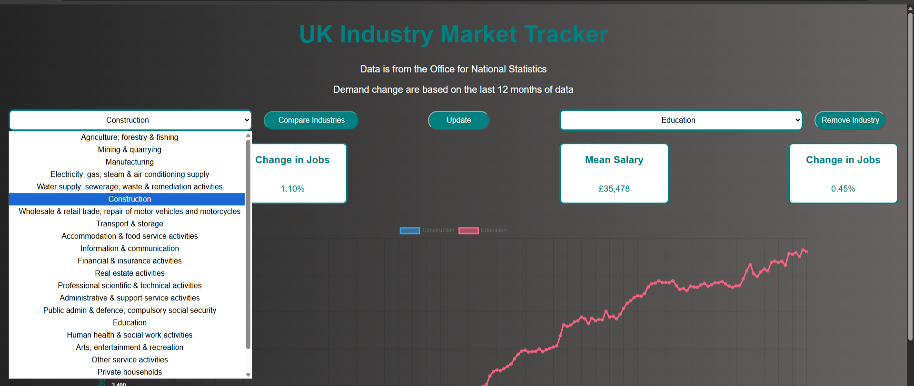
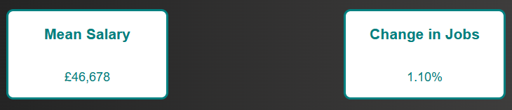

# UK Industry Market Tracker

## Overview of project

The UK Industry Market Tracker is a personal project I have done which is an interactive data dashboard designed to analyse and compare employment trends and mean salary information across different UK industries. Industries include:

- Agriculture, forestry and fishing
- Mining and quarrying
- Manufacturing
- Electricity, gas, steam and air conditioning supply
- Water supply, sewerage, waste management and remediation activities
- Construction
- Wholesale and retail trade, repair of motor vehicles and motorcycles
- Transportation and storage
- Accommodation and food service activities
- Information and communication
- Financial and insurance activities
- Real estate activities
- Professional, scientific and technical Activities
- Administrative and support service activities
- Public administration and defence, compulsory social security
- Education
- Human health and social work activities
- Arts, entertainment and recreation
- Other service activities

This application uses publicly available data from the **Office for National Statistics (ONS)** to help users explore changes in employment and salaries in different industries. 

I created this project to develop my technical and programming skills better. I also did this project to have a taste of what data analysis is as well as develop skills in SQLite, Pandas, and data processing.

Development period: September 2026 - October 2026.
## Features

- **Industry comparison** - Users can compare the number of jobs and mean salary between two different industries.
- **Interactive charts** - Displays historical data from 1978 which shows the amount of jobs in a certain year.
- **Employment trends** - Explores historical employment figures.
- **Dropdowns** - Allows user to choose any industry they want.
- **Percentage change of the number of jobs** - The percentage change of the number of jobs in the past 12 months is shown to the user.

## Technologies used

- **Python** - Backend development and data processing
- **Pandas** - Fetching, cleaning, and manipulating data
- **SQLite** - Database management
- **Flask** -  Web application framework
- **HTML & CSS** - Dashboard structure and styling
- **JavaScript** - Adds interactive functionality
- **Chart.js** - Displays charts

Others technology used with a smaller use:

- **Requests library** - To collect data from URLs
- **ZipFile Library** - To access certain file from a zipfile
- **CORS** - Connects backend to frontend

## Data Sources 

The dashboard uses data that is publicly available from the Office for National Statistics. Datasets used: 

- Workforce jobs - Employment statistics by industry ([Link](https://www.ons.gov.uk/employmentandlabourmarket/peopleinwork/employmentandemployeetypes/datasets/workforcejobsbyindustryjobs02))
- Annual Survey of Hours and Earnings (ASHE) - Salary statistics by industry ([Link](https://www.ons.gov.uk/employmentandlabourmarket/peopleinwork/earningsandworkinghours/datasets/earningsandhoursworkedbyindustryandoccupationashetable29))

## Screenshots

### Comparing Industries



### Dropdowns


### Mean salary and change in jobs display 


## Installation and setup

### Pre-requirements

- Python 3 installed - Runs backend
- Git installed - Gets repository from GitHub
- An active internet connection - Downloads required datasets

### 1. Clone the repository

```bash 
git clone https://github.com/Sunmeet686/UK-Industry-Market-Tracker.git
``` 

Navigate into the project directory:

```bash
cd uk-industry-market-tracker
```

### 2. Create virtual environment

```bash
python -m venv venv
```

Activate the virtual environment:

**Windows:**
```bash
venv\Scripts\activate
```

**Mac/Linux:**
```bash
source venv/bin/activate
```

### 3. Install dependencies

```bash
pip install -r requirements.txt
```

### 4. Run the application

Start the Flask application:

```bash
python main.py
```

On startup, the application automatically:

- Downloads the required employment and salary datasets from the Office for National Statistics (ONS).
- Processes and cleans the downloaded data.
- Creates and populates the SQLite database.

An active internet connection is required each time the application starts to retrieve the datasets.

### 5. Access the dashboard

Open your web browser and navigate to:

http://127.0.0.1:5000

The dashboard should now be running locally!

# Future improvements
For further development on this website I would like to:

- Incorporating job-specific roles within each industry.
- Exploring machine learning techniques to predict future employment trends.
- Including job vacancy statistics alongside employment figures.
- Displaying the skills required for specific roles and industries.
- Introducing regional salary comparisons across the UK.